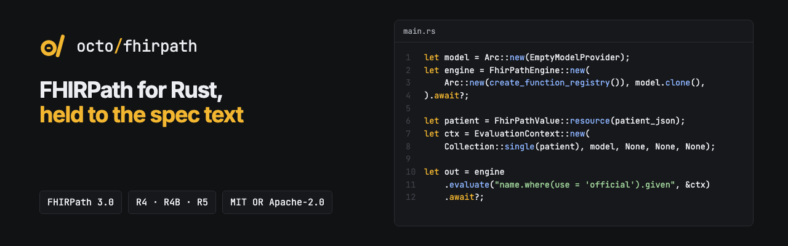

<p align="center"></p>

<p align="center"><b>A spec-first FHIRPath engine for Rust: correct, predictable evaluation over JSON FHIR resources.</b></p>

<p align="center">
  <a href="https://github.com/octofhir/fhirpath-rs/actions/workflows/ci.yml"></a>
  <a href="https://crates.io/crates/octofhir-fhirpath"></a>
  <a href="https://docs.rs/octofhir-fhirpath"></a>
  <a href="#license"></a>
</p>

## Supported Versions

| | Version |
| - | - |
| **FHIRPath** | [3.0.0 (STU3, Release 3)](https://hl7.org/fhirpath/STU3/), normative and STU parts, plus the additions in the [3.1 continuous build](https://build.fhir.org/ig/HL7/FHIRPath/) (snapshot of 2026-10-25 in [`spec/`](spec/)); checked against the official fhir-test-cases R5 and R6 FHIRPath suites |
| **FHIR models** | R4, R4B and R5 via [octofhir-fhirschema](https://crates.io/crates/octofhir-fhirschema) |
| **FHIR extensions** | FHIR-specific functions (`resolve()`, `extension()`, `memberOf()`, `conformsTo()`, ...), `%terminologies`, `%factory` and `%server` per the FHIR API Incubator |
| **Document extensions** | HL7 Java `section()`, `entry()`, `entryIn()`, `resources()`, `resourcesIn()`, `sameSubject()`, `hasCoding()`; [contract](docs/src/content/docs/document-functions.mdx) (not standard FHIRPath) |
| **SQL on FHIR** | `getResourceKey()` / `getReferenceKey()` behind the `sql-on-fhir` feature |
| **Rust** | 1.98 or newer (MSRV, `rust-version` in `Cargo.toml`), edition 2024 |

## 🔌 Pluggable Architecture

**This library is highly pluggable.** In production, you can use our ModelProvider and other ecosystem components, or create your own custom implementations. The architecture supports:

- Custom ModelProvider implementations for FHIR structure definitions
- Pluggable terminology providers (tx.fhir.org, local, custom)
- User-defined function registries and extensions
- Custom evaluation contexts and variables

**Production-ready CLI**: Our CLI already integrates all ecosystem providers and can be used on a daily basis for FHIRPath evaluation, REPL sessions, and server mode.

**Docs**: [API Documentation](https://docs.rs/octofhir-fhirpath) | **Spec coverage**: [TEST_COVERAGE.md](TEST_COVERAGE.md) | **Benchmarks**: [benchmark.md](benchmark.md) | **CLI**: [crates/fhirpath-cli/README.md](crates/fhirpath-cli/README.md) | **License**: MIT OR Apache-2.0

For exact source decimals, use [`Collection::from_json_str`](docs/src/content/docs/json-precision.mdx).
Known official snapshot differences and cast compatibility are [documented separately](docs/src/content/docs/conformance-differences.mdx).

## Core Principles

- **Spec-first**: FHIRPath 3.0.0 (with 3.1 CI additions) implemented against the spec text and the official tests
- **Deterministic**: pure, predictable evaluation with no hidden state
- **Safe & Fast**: no unsafe code, thread-safe, async-ready
- **Pluggable**: decoupled engine, model provider, and terminology
- **Clear diagnostics**: transparent errors and detailed metadata
- **Zero warnings**: passes all clippy lints and maintains clean code standards

## Installation

### Library

Add to your `Cargo.toml`:

```toml
[dependencies]
octofhir-fhirpath = "0.5"
```

### CLI

```bash
cargo install --git https://github.com/octofhir/fhirpath-rs fhirpath-cli
```

## Quick Start

The engine takes an explicit function registry and model provider; the evaluation
context wraps the input collection. `EmptyModelProvider` evaluates without FHIR type
information:

```rust
use std::sync::Arc;

use octofhir_fhirpath::{
    Collection, EmptyModelProvider, EvaluationContext, FhirPathEngine, FhirPathValue,
    create_function_registry,
};
use serde_json::json;

#[tokio::main]
async fn main() -> octofhir_fhirpath::Result<()> {
    let model = Arc::new(EmptyModelProvider);
    let engine = FhirPathEngine::new(Arc::new(create_function_registry()), model.clone()).await?;

    let patient = FhirPathValue::resource(json!({
        "resourceType": "Patient",
        "name": [{ "use": "official", "family": "Smith", "given": ["Alice", "A."] }],
        "active": true
    }));
    let context = EvaluationContext::new(Collection::single(patient), model, None, None, None);

    // "name.given" is evaluated against the root resource, like "Patient.name.given"
    let result = engine
        .evaluate("name.where(use = 'official').given", &context)
        .await?;
    println!("{:?}", result.value);
    Ok(())
}
```

When expressions need FHIR type information, pass a schema-backed provider instead, such as `octofhir_fhirschema::EmbeddedSchemaProvider::r4()` from
[octofhir-fhirschema](https://crates.io/crates/octofhir-fhirschema). The remaining
`EvaluationContext::new` arguments are the optional terminology, validation and trace
providers.

## CLI Usage

```bash
octofhir-fhirpath evaluate "Patient.name.given" --input patient.json
octofhir-fhirpath repl --input patient.json
octofhir-fhirpath server --port 8080
```

See [crates/fhirpath-cli/README.md](crates/fhirpath-cli/README.md) for full options and output formats.

## Architecture

- **Parser**: Configurable AST generation with validation
- **Evaluator**: `FhirPathEngine` with AST cache and auto-context detection
- **Values**: Rich type system with UCUM quantities, temporal types, JSON-backed resources
- **Context**: Built-in variables (`%context`, `%resource`, `%terminologies`, `%sct`, `%loinc`, etc.)
- **Pluggable**: ModelProvider trait for FHIR structure definitions, opt-in terminology

## Key Features

- **Zero-copy evaluation**: `Arc<JsonValue>` for efficient resource sharing
- **Deterministic**: No implicit IO, all external services are explicit
- **Smart context**: Auto-detects FHIR root context (`name.given` → `Patient.name.given`)
- **Performance**: AST cache for repeated expressions
- **JSON-first**: Direct integration with real-world FHIR payloads
- **Precision**: UCUM quantities and precise temporal operations
- **Metadata-aware**: Optional type/path/index preservation for tooling

## Code Quality

- **No unsafe code**: the library crate is compiled with `#![deny(unsafe_code)]`
- **Clippy clean**: lints are part of the quality gate
- **Tested**: unit and integration tests in `crates/octofhir-fhirpath/tests`, plus the
  spec suites described below

Run `just qa` (format, clippy, tests) to verify all quality checks pass.

## Spec Compliance

The engine tracks FHIRPath 3.x (STU3, with the 3.1 CI build in [`spec/`](spec/)).

- **Curated gate**: `just test-coverage` runs 1291 tests (the R5 suite plus FHIRPath 3
  features) and every one must pass. See [TEST_COVERAGE.md](TEST_COVERAGE.md).
- **Official suites**: the current [fhir-test-cases](https://github.com/FHIR/fhir-test-cases)
  R5 and R6 suites live in [`test-cases/official`](test-cases/official/) and run with
  `just test-official-r5` / `just test-official-r6` (report only). Of the tests that run,
  98.7% (R5) and 98.8% (R6) pass; the Java RI `documentFunctions` group is skipped.

FHIRPath 3.x features include instance selectors (`Coding { system: 'x', code: 'y' }`,
`{ : }`), `sort()` with `asc`/`desc`, `pathname()`, the Long type with `toLong()`,
the date/time component functions, `duration()`/`difference()`, `toDate()`/`toDateTime()`
with format codes, regex flags, and quantities per the 3.1 unit rules: UCUM arithmetic
(`3 'm' + 3 'cm'` is `303 'cm'`, `12 'cm' * 3 'cm'` is `36 'cm2'`), `toQuantity(unit)`,
calendar/UCUM time units in equality and equivalence (`1 year = 12 months`), and
`%rootResource`.
The `%factory` API follows the FHIR API Incubator, and the SQL on FHIR functions
`getResourceKey()` / `getReferenceKey()` are available behind the `sql-on-fhir` feature.

Compile-time `is`-guard checks (§1.11.1) are available through
`parse_with_type_guard_analysis`.

Known gaps: the precision of decimals written with an exponent in JSON input (`9.5e2`) for
`lowBoundary`/`highBoundary`. Where the official tests and the specification text disagree,
the engine follows the specification: `distinct()` of incomparable dates,
calendar-duration comparisons (`1 year > 2 months` is `true`, since 1 year = 12 months),
and the result type of `@2014.highBoundary(6)` (a Date). `as()` on a multi-item collection
is applied per item, because FHIR's own invariants rely on it.

## Resources & Support

- 📚 **[API Docs](https://docs.rs/octofhir-fhirpath)** - Complete API reference
- 🐛 **[Issues](https://github.com/octofhir/fhirpath-rs/issues)** - Bug reports and features
- 💬 **[Discussions](https://github.com/octofhir/fhirpath-rs/discussions)** - Community support
- 🌟 **[FHIRPath Spec](http://hl7.org/fhirpath/)** - Official specification
- 💝 **[Sponsor](https://boosty.to/octoshikari)** - Support development

## License

Licensed under either of [MIT](LICENSE-MIT) or [Apache-2.0](LICENSE-APACHE), at your option.

---

**Built by the OctoFHIR team**